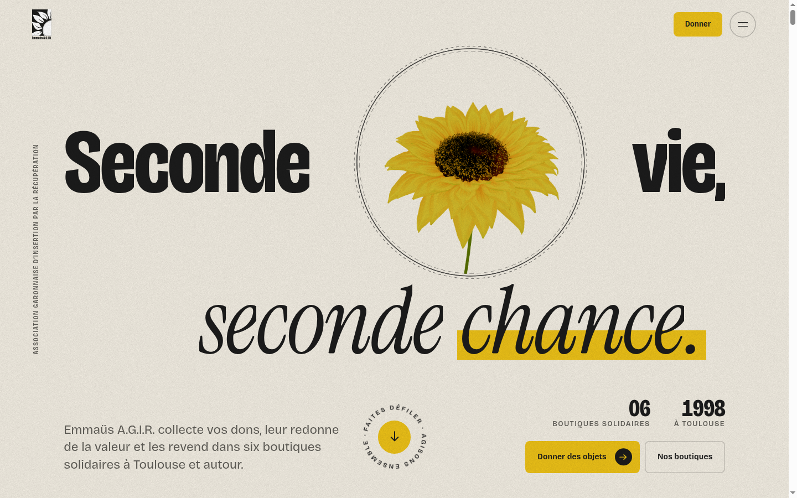
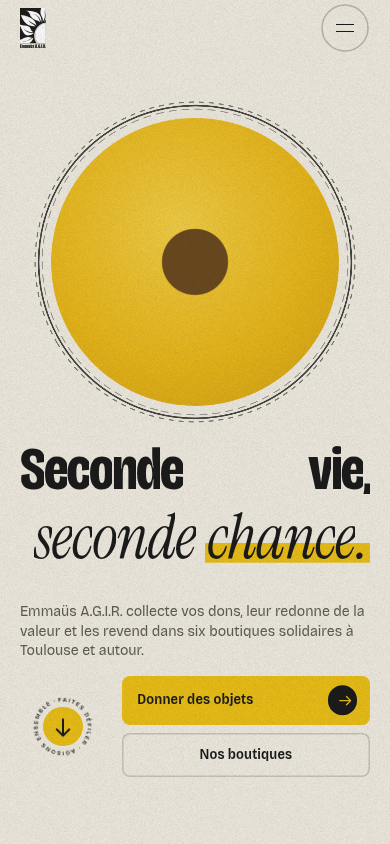

# Vaani-Dalal Design Specification

## Evidence and use boundary

The public reference at `https://emmaus-agir-31.fr/` was inspected read-only with REA on 2026-11-10. The images below are captured documentation at the requested viewport sizes; they are not Vaani-Dalal product assets. No source-site text has been transcribed, and no reference image, video, logo, font file, domain, brand mark, or illustration is used in the product. The REA CLI was checked from outside the project and the requested browser-observation tools were exposed through a task-scoped connector; its setup dry-run was reviewed, with no broader agent configuration written.

| Capture | CSS viewport | Saved file |
| --- | ---: | --- |
| Desktop | 1440 × 900 | `docs/reference/reference-desktop-1440x900.png` |
| Mobile | 390 × 844 | `docs/reference/reference-mobile-390x844.png` |

## Measured reference design

### Color tokens

Values below are computed CSS custom properties or computed colors, not estimates from screenshot pixels.

| Token | Computed value | Observed role |
| --- | --- | --- |
| `--fond` | `#f1ece1` | Main warm paper field |
| `--fond-2` | `#e7e1d3` | Secondary paper surface |
| `--ink` / `--gris` | `#1b1b1b` | Main text/ink |
| `--gris-doux` | `#5f5d57` | Muted text |
| `--bleu` | `#33669b` | Blue accent |
| `--vert` | `#43744e` | Green accent |
| `--jaune` | `#ebc017` | Yellow accent |
| `--ligne` | `rgba(27,27,27,0.18)` | Fine rules and outlines |

Other observed variables: `--tap: 44px`, `--radius-pill: 999px`, `--gutter: max(clamp(20px,4vw,64px),0px,0px)`, `--fs-display: clamp(3.2rem,0.8rem + 7.2vw,11.5rem)`, `--fs-h2: clamp(2.5rem,1.3rem + 4.6vw,6.5rem)`, `--fs-h3: clamp(1.6rem,1.1rem + 1.6vw,2.75rem)`, `--fs-body: clamp(1rem,0.95rem + 0.2vw,1.125rem)`, `--fs-lead: clamp(1.125rem,1rem + 0.45vw,1.5rem)`, and `--fs-label: clamp(0.75rem,0.72rem + 0.12vw,0.8125rem)`. Easing variables include `cubic-bezier(0.16,1,0.3,1)`, `cubic-bezier(0.65,0,0.35,1)`, and `cubic-bezier(0.34,1.8,0.64,1)`.

### Typography

| Element | Desktop at 1440px | Mobile at 390px |
| --- | --- | --- |
| Body | Bricolage Grotesque with system sans fallback; 18px / 27px; weight 400 | Same family stack; 16px / 24px; weight 400 |
| Hero heading | Bricolage Grotesque; 164.8px / 138.432px; weight 740; letter spacing `-6.592px`; about 3 rendered lines | Same family; 60.45px / 50.778px; weight 740; letter spacing `-2.418px`; about 9 rendered lines |
| Secondary display family | Instrument Serif with fallback was loaded | Instrument Serif with fallback was loaded |

The line-count measurement is the heading element's rendered height divided by computed line-height; it intentionally records no source wording or textual line-break content. The source fonts are evidence only and will not be included in the product.

### Layout and structure

At 1440 × 900 the CSS viewport reports 1440px wide and the page body is 1425px wide after the browser scrollbar. At 390 × 844 the body is 390px wide with no horizontal overflow in the captured measurement. The header is `position: fixed`, 88px high on desktop and 56px on mobile; its measured horizontal padding is 57.6px and 20px respectively. The main page contains five top-level sections.

| Section | Desktop top / height | Mobile top / height |
| --- | ---: | ---: |
| 1 | 0 / 1,890px | 0 / 1,604px |
| 2 | 1,890 / 5,040px | 1,604 / 4,051px |
| 3 | 6,930 / 13,500px | 5,655 / 10,972px |
| 4 | 20,430 / 5,580px | 16,627 / 5,233px |
| 5 | 26,010 / 2,143px | 21,860 / 2,445px |

The desktop hero heading box measures x=115px, y=211px, width=1,195px, height=454px. The mobile box measures x=20px, y=102px, width=350px, height=466px, with 336.68px top padding within its box. The screenshot shows a fixed top header, very large display type and a central circular visual; on mobile the circle moves above the heading and calls stack vertically. A second section has a sticky content aside at `top:112px`. A fixed full-viewport menu contains ten link elements when present; passive inspection does not establish a persistent numbered scene-navigation rail. The footer measures 777px high on desktop and includes separate legal/social navigation with six links; no footer button was found in the passive structure. The product brief's numbered rail and footer CTA will therefore be original Vaani-Dalal features, not claimed copies of the reference.

### Motion and implementation evidence

Computed CSS keyframe names include `spin`, `hero-bob`, `grain`, `pulse-dot`, and `pin-pulse`. First-party bundle paths use Next.js Pages Router chunks; static fingerprints in a loaded bundle include GSAP, ScrollTrigger and Splitting, alongside React/Next.js. This is bundle-string evidence, not a full audit of runtime imports or dependency versions. A Lenis marker appears in the rendered DOM, but a Lenis runtime import is not confirmed. The Vaani-Dalal build uses the requested App Router, with its own motion design and original code.

## Vaani-Dalal visual system

The design adapts only a broad editorial rhythm: large left-aligned words, generous paper space, numbered sections, clear state labels, and motion that explains the call. Its palette and content are original.

| Token | Value | Use |
| --- | --- | --- |
| `--paper` | `#F5EFE4` | Warm page canvas |
| `--ink` | `#1E2621` | Main text and line art |
| `--signal` | `#D9583B` | Ownable active-call vermilion |
| `--sage` | `#D5DED2` | Calm, complete or safe states |
| `--muted` | `#73756B` | Secondary labels |
| `--line` | `rgba(30,38,33,.16)` | Rules and dividers |

Use Georgia/Times-style serif display text with the system UI sans stack for body/controls and system monospace for state labels, timing and protocol cues. Do not fetch or bundle the reference site's fonts. The original wordmark uses a Vaani-Dalal word treatment with a concentric voice-orbit glyph and a small interruption notch. Waveforms and bridges are original SVG/CSS line drawings, never reference imagery.

At desktop, align the hero on a left text rail beside an original signal-orbit instrument panel; keep numbered proof points offset below. On mobile, stack the orbit above the heading and preserve 44px minimum touch targets. The call journey uses an accessible seven-step scrubber (`Dial`, `IVR`, `Hold`, `Human`, `Whisper`, `Patch-in`, `Summary`) beside a transcript/state panel. Two narrative scenes explain Whisper and Patch-in; an SVG path links the six-week roadmap and ten-state machine. The footer ends with the original “Let the AI make the call.” waitlist CTA and clear simulated-demo disclosure.

Entrance reveals use short opacity/transform changes without layout shifts. GSAP/ScrollTrigger handles optional section progress and path drawing; Lenis handles optional smooth scroll only when reduced motion is off and the user has not requested native scrolling. `prefers-reduced-motion` removes pinned scenes, parallax, smooth-scroll inertia and ambient waveform animation while retaining state text, controls and simple fades. Every call control is keyboard/touch accessible; waveform state is never conveyed by color alone.

## Reference captures

### Desktop — 1440 × 900

### Mobile — 390 × 844

